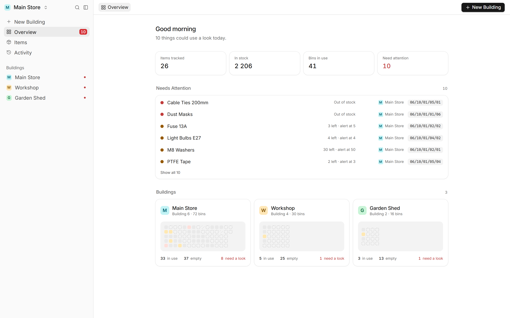
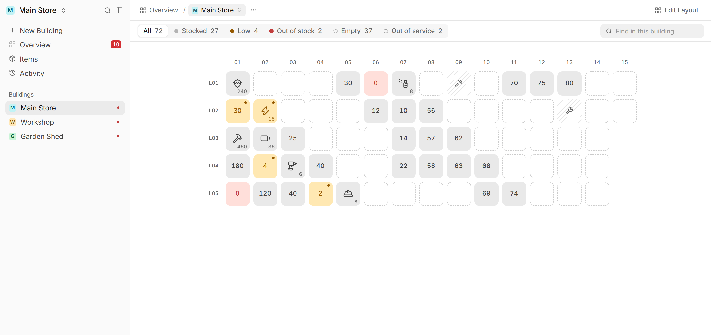
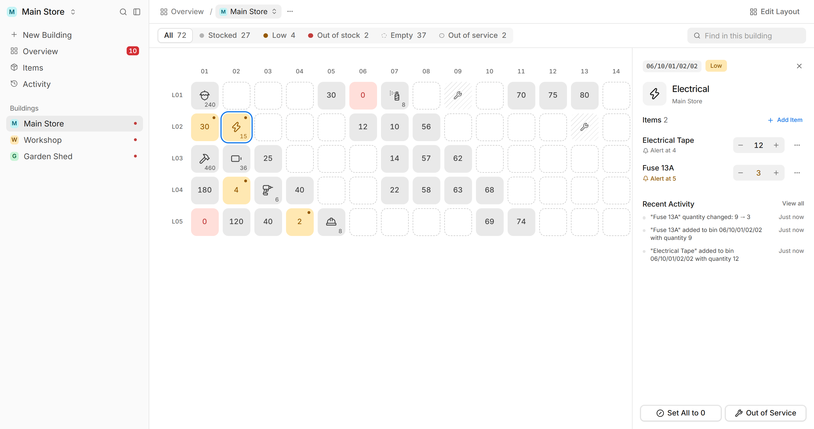
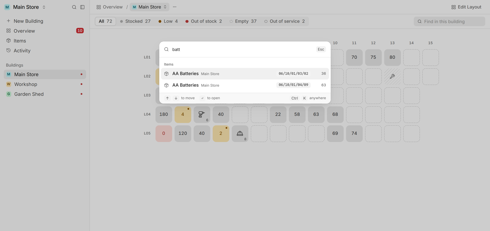
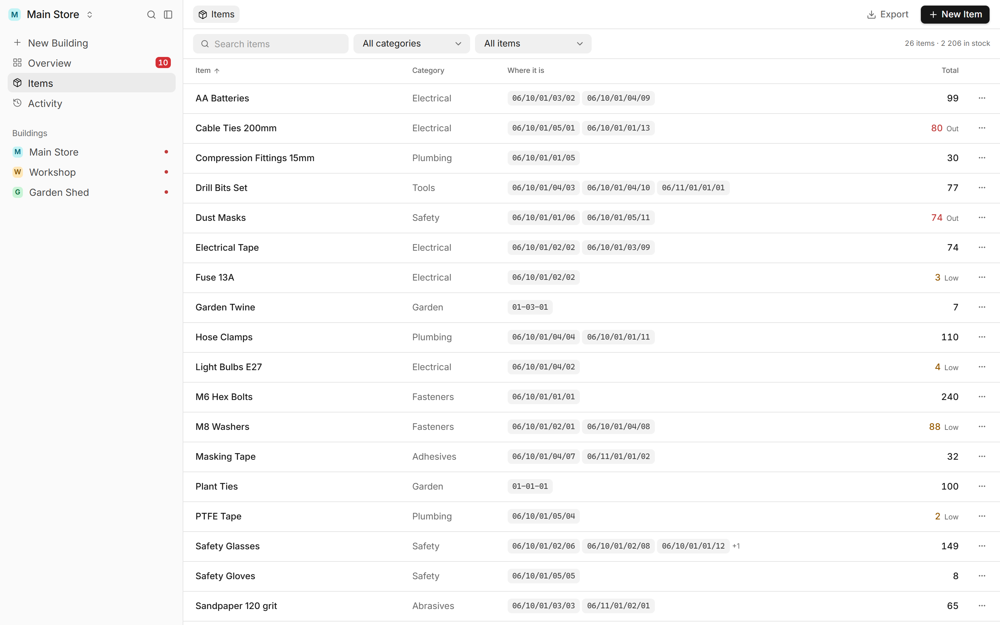
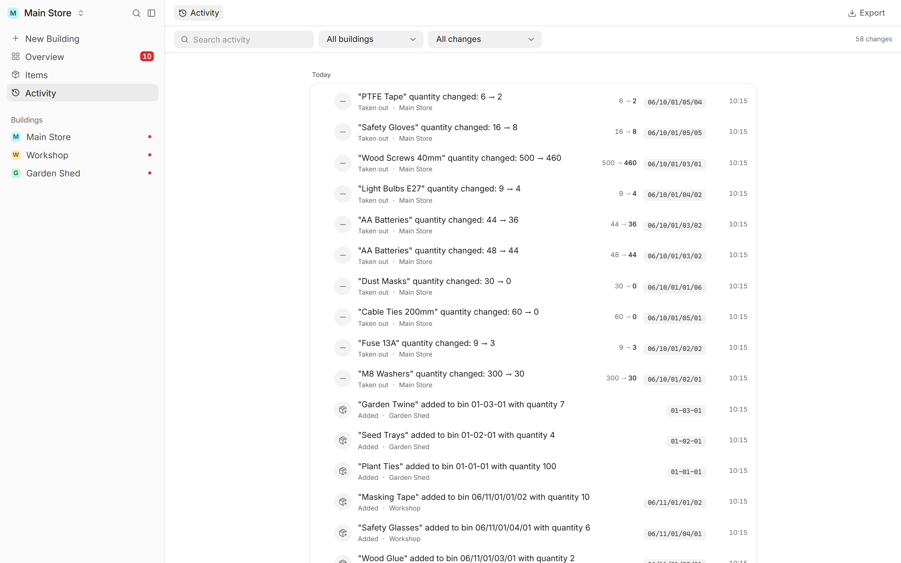
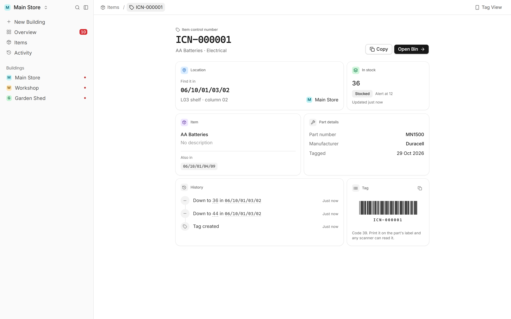
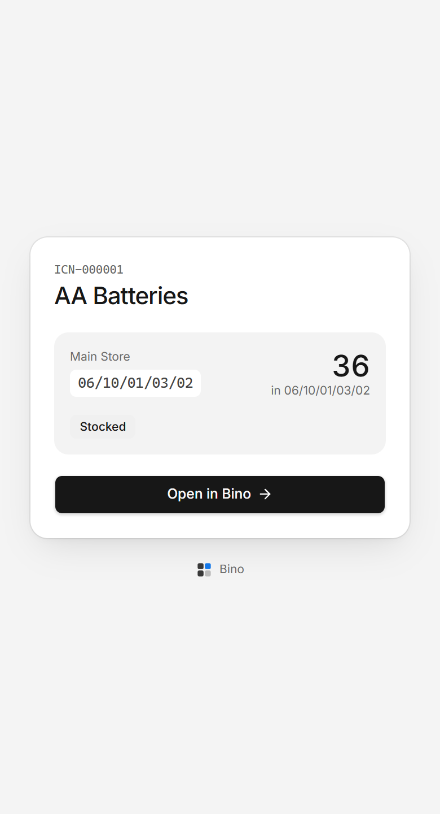
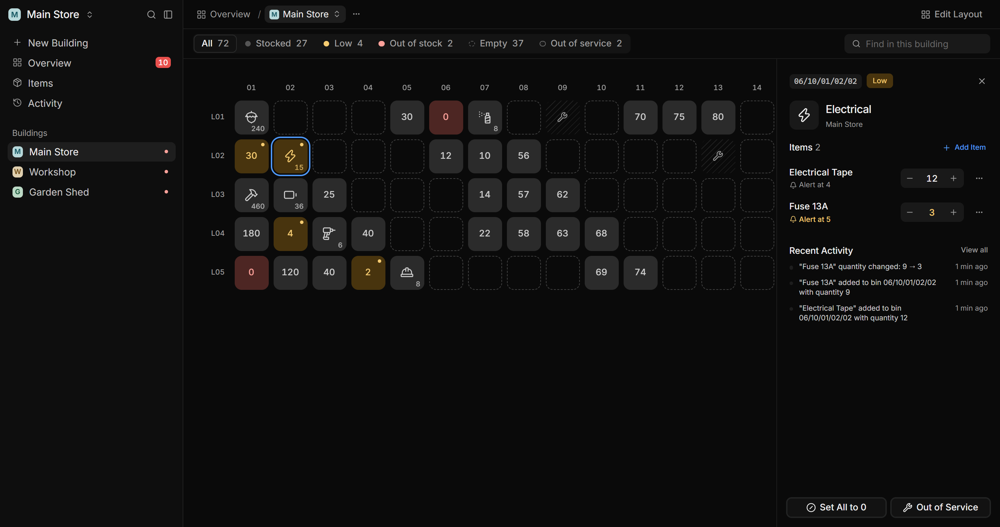

<div align="center">


# Bino

**Know what's in every bin, in every building, at a glance.**

A calm, simple inventory app for small stores and workshops. It shows where every part lives, flags what's running low, and keeps a record of every change.

<br />



</div>

<br />

## The problem

Plenty of small operations keep their stock in rows of labelled bins spread across a few buildings: a main store, a workshop, a shed out back. The information about those bins usually ends up in a spreadsheet, on a clipboard, or in one person's head. That causes a few familiar problems:

- **Nobody knows something has run out** until someone needs it.
- **Finding a part means walking the shelves**, because the spreadsheet says "bolts" but not which bin.
- **Bin codes drift.** Each building numbers its shelves a little differently, and the labels stop matching the records.
- **There's no history.** When a count is wrong, there's no way to tell who changed it or when.

Off-the-shelf inventory software tends to be built for warehouses and retailers. It's packed with purchase orders, SKUs and dashboards, which is too much for the person actually doing the upkeep. **Bino is built for that person.** They aren't technical, so every screen has to make sense without any explanation.

## What it does

### See every building as it really is

Each building is a grid of its actual bins, laid out by shelf and column. You can tell how a bin is doing at a glance, and the legend at the top doubles as a filter.



| Status | Looks like | Means |
| --- | --- | --- |
| Stocked | Calm grey | All good |
| Low | Amber, with a dot | Something hit its alert level |
| Out of stock | Red, showing **0** | Something has run out |
| Empty | Dashed outline | Nothing assigned yet |
| Out of service | Hatched | Bin is broken or unavailable |

Status never relies on colour alone, so it still reads for colour-blind users and in greyscale printouts.

### Update stock in a click

Click a bin and its details open in a panel beside the grid. Adjust counts with − / +, set a low-stock alert, add notes, move items to another bin, or mark the bin out of service. Arrow keys move from bin to bin without closing anything.



### Know what needs attention

The **Overview** starts the day with a short list: anything out of stock, running low, or out of service, each linked straight to its bin.

### Find anything, from anywhere

Press <kbd>Ctrl</kbd> <kbd>K</kbd> (or <kbd>/</kbd>) and start typing an item, part number, bin code or building. Results jump straight to the bin.



### Every item, every bin it's in

The **Items** page lists the whole catalogue with totals and every location, with search, category filters and a "low or out" filter. Export to CSV for stock-takes.



### A full history, in plain language

Every change is recorded and grouped by day, with filters for building and type of change. Nothing gets lost, and mistakes are easy to trace.



### Part labels with real barcodes

Parts can carry an **ICN** (item control number), either generated or typed in from an existing tag. Each ICN gets its own page with where the part lives, how many are left, its history, and a printable Code 39 barcode that any USB scanner can read. A phone-sized version is there for scanning a label on the shelf.

<table>
  <tr>
    <td width="72%"></td>
    <td width="28%"></td>
  </tr>
</table>

### And the small things that make it pleasant

- **Undo, not "Are you sure?"** Everyday actions happen right away and come with an Undo toast. Confirmation dialogs are kept for things that really can't be undone.
- **Bin codes that stay consistent.** Each building follows a code format (for example `Group / Store / Row / Rack / Bin` → `06/10/01/03/02`), with a plain-language editor and a live preview. Buildings that share a format still get unique codes.
- **Keyboard shortcuts** for everything common. Press <kbd>?</kbd> to see them all.
- **Right-click menus** on bins and buildings for quick actions.
- **Light and dark mode**, following your system or set manually.



## Built for one person to love using

Bino was designed around a single, specific user: the person who looks after the stores every day. That set the rules:

- **Obvious beats clever.** If a screen needs explaining, it gets redesigned.
- **Colour means something.** The interface is neutral grey. Colour is used only for bin status and for selection, so problems stand out in a grid of 60+ bins.
- **Fast by default.** Changes appear instantly and save in the background. If the server rejects one, it rolls back.
- **Forgiving.** Undo for everyday mistakes, and a clear warning only when something can't be taken back.

The reasoning behind these calls, including the alternatives that were tried and dropped, is written up in [`DECISIONS.md`](DECISIONS.md). User-facing changes are tracked in [`CHANGELOG.md`](CHANGELOG.md).

## Under the hood

| Layer | Tech |
| --- | --- |
| **Web app** | React 19 with the React Compiler, Vite, Tailwind CSS v4, React Router 7, Base UI, Zustand, Motion |
| **API** | Node, Express, Prisma |
| **Database** | PostgreSQL (Supabase) |
| **Hosting** | Vercel (web), Render (API) |
| **Mobile (planned)** | Expo / React Native |
| **Tooling** | pnpm workspaces, TypeScript (strict), oxlint |

A few engineering choices worth highlighting:

- **Monorepo with shared packages.** Types, the location-code engine, the state stores and the UI kit are separate workspace packages, so the web app, the API and the future mobile app all use the same logic.
- **A location-code engine** (`@bino/data`) turns a building's shelf/row/column layout and code format into human-readable bin codes, and works out where the next bin should go. The API and the UI use the same functions, so they always agree.
- **Derived, never stored, status.** A bin's status is calculated from its contents every time, so it can't fall out of sync with the data.
- **Optimistic updates with rollback.** The API returns the history event it recorded, and the client adds it to the timeline straight away, with no refetching.
- **One indexed view of the data.** Everything loads once at startup and is indexed into lookup maps, so screens never filter large arrays during render.

## Project structure

```
bino/
├── apps/
│   ├── desktop/     The web app (Vite + React)
│   ├── api/         Express + Prisma REST API
│   └── mobile/      Expo app, the future scanner "remote"
└── packages/
    ├── types/       Shared TypeScript types
    ├── data/        Location-code engine and default code formats
    ├── store/       Zustand stores and the API client
    └── ui/          Base UI components and design tokens
```

## Running it locally

You'll need Node, [pnpm](https://pnpm.io) and a PostgreSQL database.

```sh
pnpm install

# API (http://localhost:3001)
cd apps/api
cp .env.example .env            # set DATABASE_URL and DIRECT_URL
npx prisma migrate deploy
npx tsc -b                      # build the shared packages
pnpm prisma:seed                # add the default bin code formats
cd ../..
pnpm api dev

# Web app (http://localhost:5173)
VITE_API_URL=http://localhost:3001 pnpm desktop dev
```

## What's next

The next step is **scanning**. Bins will get QR stickers with a fixed ID, so a printed label keeps working even if the building's code format changes. The Expo app will become a lightweight "remote" for walking the shelves: scan a sticker, see what's there, adjust a count, done. Management stays on the desktop. The full plan is in [`docs/scanner.md`](docs/scanner.md).

<br />

<div align="center">
<sub>Built by <a href="https://github.com/simplyyliam">Liam</a></sub>
</div>
